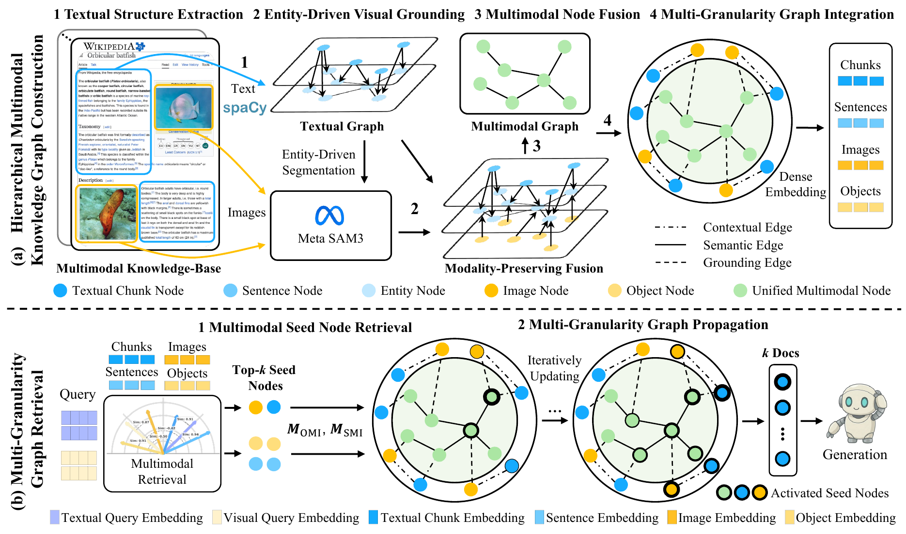
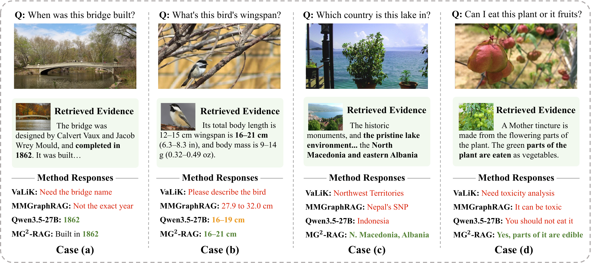
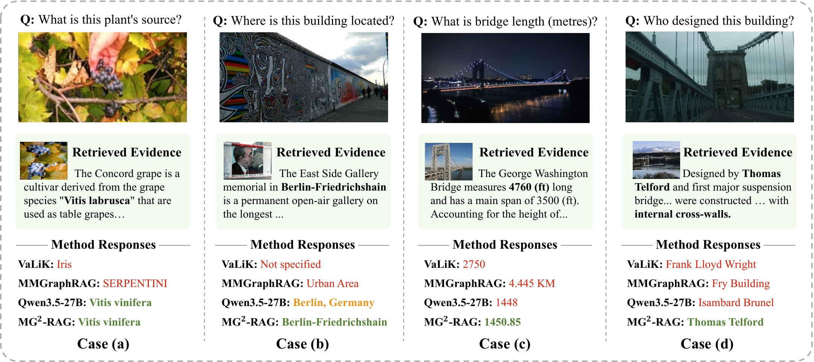
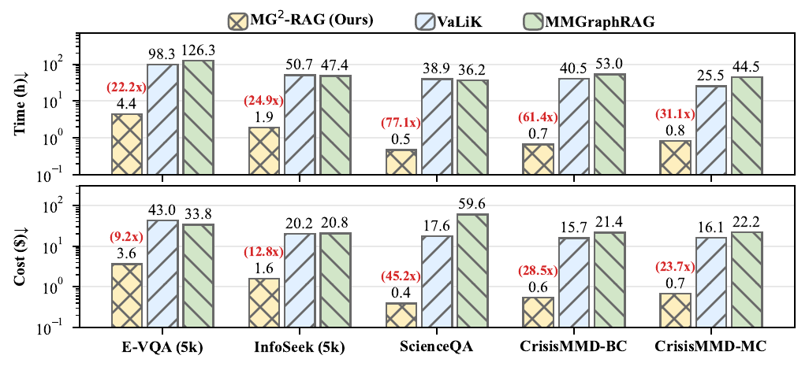

<p align="center">
  <a href="https://daboolu.github.io/MG2-RAG/">
    
  </a>
</p>


Official implementation of **MG²-RAG: Multi-Granularity Graph for Multimodal
Retrieval-Augmented Generation**.

**Sijun Dai<sup>1,†</sup>, Qiang Huang<sup>1,†</sup>, Xiaoxing You<sup>2</sup>, Jun Yu<sup>1,*</sup>**  
<sup>1</sup> Harbin Institute of Technology (Shenzhen) · <sup>2</sup> Hangzhou Dianzi University  
<sup>†</sup> Equal contribution · <sup>*</sup> Corresponding author

[[Project Page](https://daboolu.github.io/MG2-RAG/)]
[[arXiv Paper](https://arxiv.org/abs/2604.04969)]
[[Code](https://github.com/Daboolu/MG2-RAG)]



MG²-RAG constructs a hierarchical multimodal knowledge graph with lightweight
text parsing and entity-driven visual grounding. Text and image queries retrieve
evidence at chunk, sentence, image, and object granularities before Personalized
PageRank propagates relevance through the graph.

## Quick Start

The tested environment uses Python 3.10, PyTorch 2.7.0, and CUDA 12.6.

```bash
conda env create -f environment.yml
conda activate mmgraphrag
```

Download the required checkpoints:

- [BAAI/EVA-CLIP-8B](https://huggingface.co/BAAI/EVA-CLIP-8B)
- [Meta SAM3](https://github.com/facebookresearch/sam3)
- spaCy `en_core_web_trf`

Copy the example configuration and set the model paths, OpenAI-compatible
endpoint, and GPU IDs:

```bash
cp .env.example .env
```

The bundled example contains raw text, a query image, and a knowledge-base
image. It does not require an external dataset download.

```text
examples/data/impala_demo/
├── input.json
├── query_image.jpg
└── kb_image.jpg
```

Run graph construction and retrieval:

```bash
python main.py
```

This command loads the raw inputs, runs `MMGraphRAG.index`, constructs the
multimodal graph, and executes `MMGraphRAG.retrieve`. No graph or retrieval
result is precomputed by the runner.

Indexing and retrieval can also run separately while reusing the saved graph and
embedding caches:

```bash
python main.py --stage index
python main.py --stage retrieve
```

Set `DEMO_RUN_QA=true` to generate an answer with an OpenAI-compatible service.
`DEMO_QA_MODE` accepts `llm` or `mllm`.

By default, GPU 0 runs EVA-CLIP, dense retrieval, and PPR; GPU 1 runs spaCy and
SAM3 workers. These assignments can be changed in `.env`.

Every `BaseConfig` field can be overridden with
`MG2RAG_<FIELD_NAME_UPPERCASE>`, for example:

```text
ppr_damping  -> MG2RAG_PPR_DAMPING
clip_device  -> MG2RAG_CLIP_DEVICE
qa_top_k     -> MG2RAG_QA_TOP_K
```

The default retrieval configuration follows the InfoSeek setting reported in
the paper: α=0.15, ωC=1.2, ωI=0.5, λt=0.1, and λv=1.0.

Runtime artifacts are written to:

```text
outputs/impala_demo/
├── ieNer_results.json
├── graph.pickle
├── aux_maps.pkl
├── graph_summary.json
├── retrieval_output.json
├── qa_output.json
├── BAAI_EVA-CLIP-8B/
└── sam3_grounding/
```

`qa_output.json` is created when QA is enabled. Generated outputs are ignored by
version control.

## Repository Layout

```text
MG2-RAG/
├── main.py
├── examples/
│   ├── data/impala_demo/
│   ├── run_fixed_example.py
│   ├── showcase/
│   └── web/
├── src/mmgraphrag/
│   ├── MMGraphRAG.py
│   ├── embedding_model/
│   ├── grounding_model/
│   ├── information_extraction/
│   ├── llm/
│   ├── prompts/
│   └── utils/
├── sam3/
├── assets/
├── .env.example
└── requirements.txt
```

The interactive project-page source and machine-readable showcase are available
under [`examples/web`](./examples/web) and
[`examples/showcase`](./examples/showcase), respectively.

## VQA Case Studies





## Construction Efficiency



MG²-RAG reduces graph construction time and cost across E-VQA, InfoSeek,
ScienceQA, and the two CrisisMMD tasks by replacing MLLM-based graph extraction
with lightweight parsing and entity-driven visual grounding.

## Citation

```bibtex
@inproceedings{dai2026mg2rag,
  title={MG$^2$-RAG: Multi-Granularity Graph for Multimodal Retrieval-Augmented Generation},
  author={Sijun Dai and Qiang Huang and Xiaoxing You and Jun Yu},
  booktitle={Proceedings of the 19th European Conference on Computer Vision (ECCV)},
  year={2026},
}
```

## License and Third-Party Assets

This project is released under the [MIT License](LICENSE). SAM3, EVA-CLIP,
datasets, checkpoints, and showcase images remain subject to their respective
licenses and terms. Do not publish `.env`, model weights, datasets, generated
caches, or credentials.
